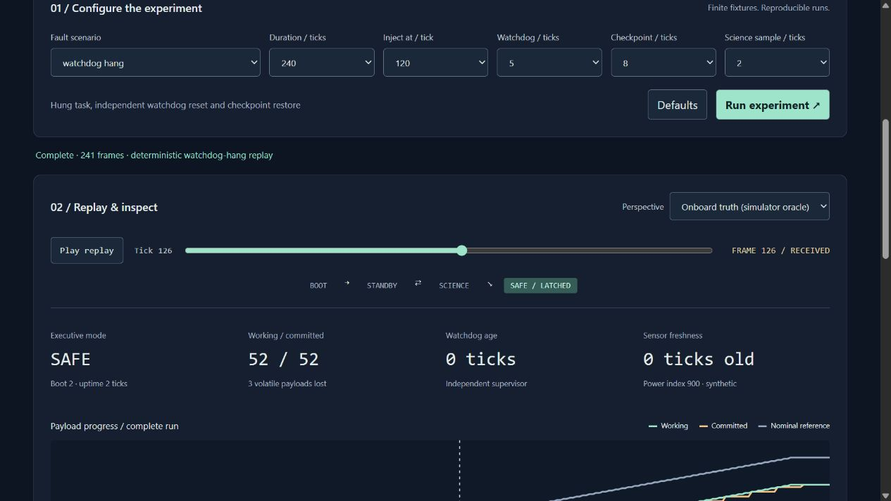

# Spacecraft Flight Software Testbed

[](https://github.com/JasonStys/spacecraft-flight-software-testbed/actions/workflows/validate.yml)
[](https://github.com/JasonStys/spacecraft-flight-software-testbed/actions/workflows/codeql.yml)

**Break a task. Prove recovery.** A deterministic C++20 executive, software-only device ports and a TypeScript mission-assurance console by [Jason Stys](https://github.com/JasonStys).

Inject a hung task, stale sensor, missing telemetry, bad checkpoint, low-power index or corrupt command. Inspect the exact reset deadline, latched SAFE mode, checkpoint restore, lost volatile work and explicit return to science. Replay every frame against an identical-setting nominal reference and export the evidence.

This is an original educational implementation—not an RTOS, cFS/NOS3 distribution, flight-qualified system, real spacecraft controller, guidance/targeting system or hardware interface. All inputs are synthetic. Logical ticks are not seconds; sensor/power indexes are not physical measurements. SAFE is a software-state label, not a real-world safety assertion.

## Try it

For a prebuilt desktop app, download the matching Windows/Linux/macOS ZIP from [Releases](https://github.com/JasonStys/spacecraft-flight-software-testbed/releases), verify its SHA-256, extract the **whole folder**, and launch `SpacecraftFlightTestbed` (`.exe` on Windows). It opens the local website in your browser. No account, Python/Node installation, cloud service or administrator access is needed. Builds are unsigned; never disable OS protections. Stop the console with Ctrl+C. Mobile browsers can display the responsive UI, but no phone-native executable is supplied and the loopback service is deliberately not shared over a network.

Source development requires Python 3.12–3.14, Node 24 and a C++20 toolchain (MSVC 2022/2026, GCC or Clang). The pinned CMake build dependency is installed below.

```powershell
python -m venv .venv
.venv/Scripts/python -m pip install --require-hashes -r requirements-dev.lock
npm ci
.venv/Scripts/python tools/build_native.py
npm run build
.venv/Scripts/python -m flightlab serve
```

On Linux/macOS substitute `.venv/bin/python`. Do not use the Python development server as a public Internet service.

## Features

| Feature                         | Evidence you can inspect                                                         |
| ------------------------------- | -------------------------------------------------------------------------------- |
| Executive / four software modes | Deterministic boot, standby, science and latched SAFE transitions                |
| Independent watchdog            | Exact heartbeat deadline, restart count and two-tick boot interval               |
| Validated checkpoints           | Explicit 20-byte little-endian format, CRC32, bounds and version checks          |
| Command discipline              | CRC checks, monotonic identifiers, duplicate suppression and health gating       |
| Simulated devices               | Invented sensor/power values and explicitly absent downlink frames               |
| Recovery ledger                 | Working vs committed payloads, volatile loss, command decisions and event timing |
| Dual perspectives               | Onboard simulator truth or received-only downlink; chart gaps stay gaps          |
| Reproducible evidence           | JSON/CSV/inert HTML, full evidence hash and build-independent replay hash        |
| Optional local history          | CLI-selected, immutable, content-verified SQLite runs; 100-run cap               |
| Portable bundles                | Native C++ worker plus frozen Python service and offline browser assets          |

```powershell
.venv/Scripts/python -m flightlab export --scenario watchdog-hang --format json --output evidence.json --history local-runs.sqlite3
```

No export is overwritten. CLI history is opt-in and never reachable through HTTP.



## Repository map

| Path                  | Responsibility                                                                                |
| --------------------- | --------------------------------------------------------------------------------------------- |
| `native/core.*`       | Executive, supervisor, scheduled tasks, command checks and finite fault fixtures              |
| `native/checkpoint.*` | Endian-independent checkpoint encoding and defensive decoding                                 |
| `native/cli.cpp`      | Fixed-argument native JSON worker; no arbitrary code or file execution                        |
| `native/tests.cpp`    | 756 configuration fixtures, command/codec contracts and 5,000 seeded byte cases               |
| `flightlab/`          | Strict worker bridge, loopback service, evidence reports, immutable SQL history and CLI       |
| `web/`                | Accessible responsive console, gap-aware plots, replay and finite local preferences           |
| `tests/`              | Independent Python oracles, actual HTTP/CLI/SQL and three-engine browser tests                |
| `tools/`              | Native build, replay verification, exact-line documentation, packaging and guarded release    |
| `.github/workflows/`  | Cross-platform validation, sanitizers/coverage, CodeQL and draft-only release                 |
| `docs/`               | All guides, architecture decisions, limitations, security, test results and source references |

Every individual file is summarized in [FILE_CATALOG](docs/FILE_CATALOG.md). Headers describe responsibilities and variable roles; [CODE_INDEX](docs/CODE_INDEX.md) provides generated exact source locations rather than stale hand-maintained line numbers.

## Validate

```powershell
.venv/Scripts/python -m ruff check flightlab tests tools launcher.py
.venv/Scripts/python -m ruff format --check flightlab tests tools launcher.py
.venv/Scripts/python -m mypy flightlab
.venv/Scripts/python -m pytest --cov=flightlab --cov-report=term-missing
.venv/Scripts/python tools/validate_evidence.py
.venv/Scripts/python tools/verify_repo.py
npm run format:check
npm test
npm run build
npx playwright install chromium firefox webkit
npm run test:e2e
```

CI also runs Clang ASan+UBSan, GCC native line coverage, dependency audits, CodeQL for C++/Python/TypeScript and actual frozen executable smoke tests on three operating systems. No Actions artifacts or caches are uploaded. See [VALIDATION](docs/VALIDATION.md) for measured results and limitations; green checks are not flight certification or proof of absence of defects.

## Documentation

[User guide](docs/USER_GUIDE.md) · [Executive model](docs/EXECUTIVE.md) · [Architecture/ADRs](docs/ARCHITECTURE.md) · [API](docs/API.md) · [Security](docs/SECURITY.md) · [Validation](docs/VALIDATION.md) · [Release/rollback](docs/RELEASE.md) · [References/licenses](docs/THIRD_PARTY.md).

For questions or defects, open a repository issue with the scenario/settings and expected vs observed behavior. For private security concerns, follow [SECURITY](docs/SECURITY.md). Do not post credentials or private operational telemetry. MIT licensed; created by Jason Stys. No agency or vendor endorsement is implied.
